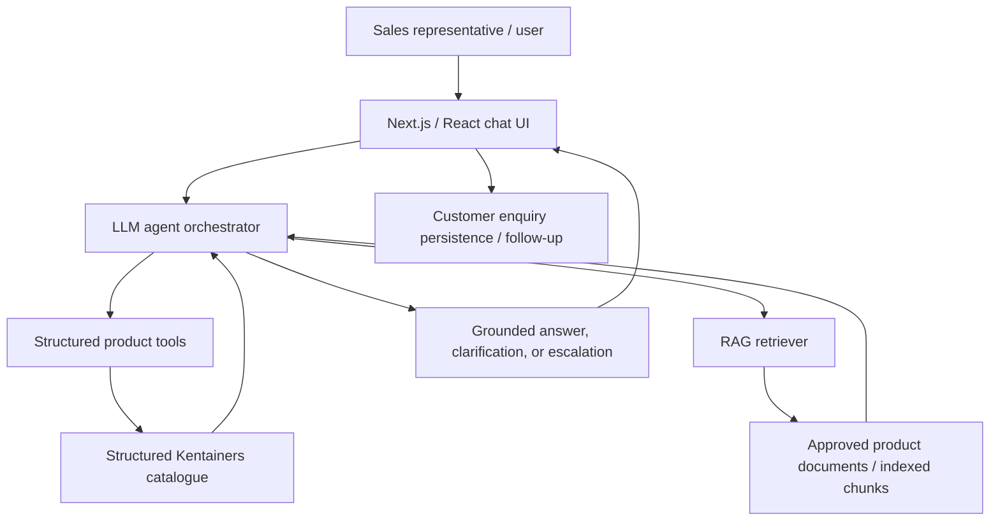

# KPIA Architecture

## Design boundaries
- Ground product facts in approved evidence.
- Clarify ambiguous customer requirements.
- Escalate when evidence is missing or conflicting.
- Do not invent current prices, stock, delivery dates, warranty, certification, compatibility, or technical specifications.
- Keep secrets in server-side environment variables.
- Decision support only; no autonomous irreversible transactions.
